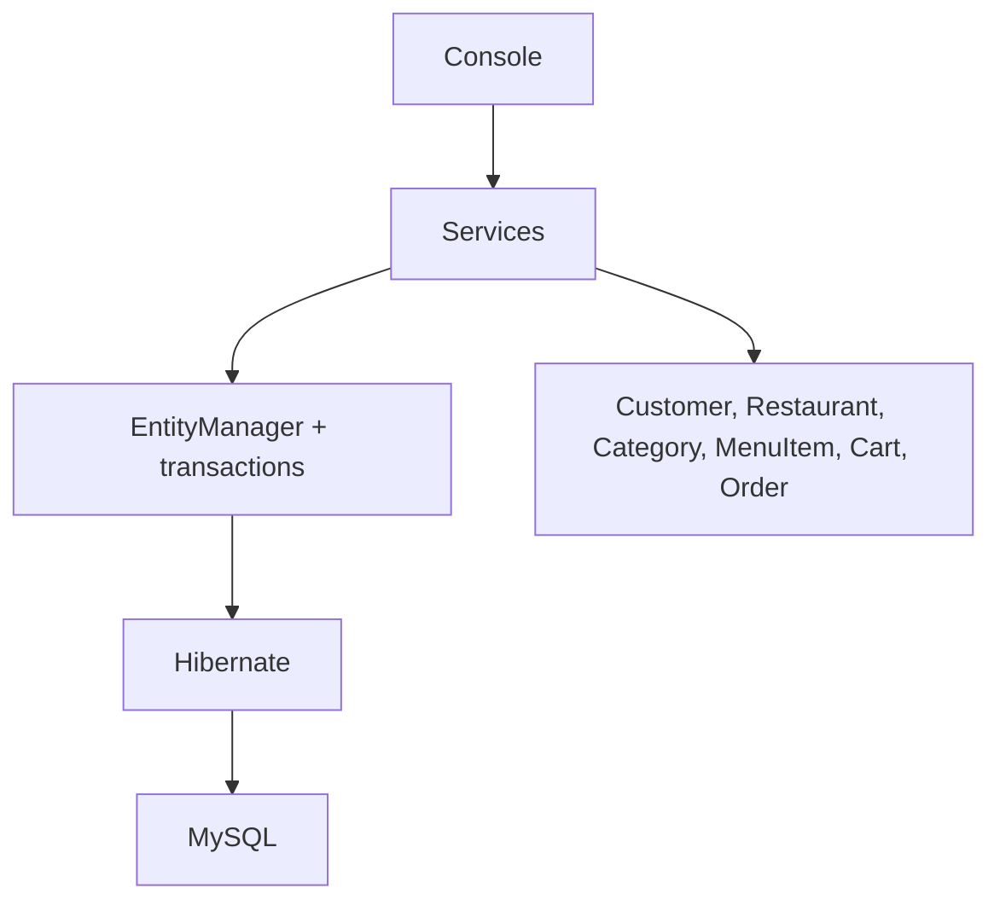

# Food Ordering Management System

Console-based Java project using Jakarta Persistence API (JPA), Hibernate ORM, Maven, and MySQL. It demonstrates entity relationships, CRUD workflows, persistent cart storage, transactional checkout, order status transitions, and JPQL reporting. No Spring Boot, frontend, REST API, authentication, or real payment processing is included.

## Stack
- Java 25 (latest LTS)
- Maven 3.9+
- Hibernate ORM 6.6.1.Final / Jakarta Persistence 3.1
- MySQL 8.x / MySQL Connector/J 9.1.0
- JUnit Jupiter 5.11.3

## Setup
1. Install JDK 25+, Maven, and MySQL 8.
2. Create the database: `CREATE DATABASE food_ordering_db CHARACTER SET utf8mb4 COLLATE utf8mb4_unicode_ci;` (or run `database/schema.sql`).
3. Create a private `.env` file and set your local MySQL username and password. The Windows run script loads `.env` automatically; process environment variables take precedence. `.env` and `.env.example` are ignored by Git; do not commit real credentials.

Windows PowerShell (create and edit your private local configuration):
```powershell
notepad .env
```

Add these settings to `.env`, using the credentials configured in your local MySQL server:
```dotenv
DB_URL=jdbc:mysql://localhost:3306/food_ordering_db?useSSL=false&serverTimezone=UTC
DB_USER=root
DB_PASSWORD=YOUR_MYSQL_PASSWORD
HIBERNATE_DDL=update
```
Do not paste database passwords into chat or source control.
Linux/macOS:
```bash
export DB_URL='jdbc:mysql://localhost:3306/food_ordering_db?useSSL=false&serverTimezone=UTC'
export DB_USER='root'
export DB_PASSWORD='YOUR_MYSQL_PASSWORD'
export HIBERNATE_DDL='update'
```
Never commit real credentials. `HIBERNATE_DDL=update` is for local development; production should use migrations.

## Build and run
Run these commands from the project root (the folder containing `pom.xml`). Do not compile `Main.java` or `SampleDataLoader.java` directly with `javac`; this Maven project must be compiled and run with its full source tree and dependencies.

Windows PowerShell:
```powershell
.\scripts\run.ps1
```

The script selects an installed Java 25 JDK and starts the application through Maven in quiet mode. Database SQL and Hibernate startup logs are hidden, so the terminal focuses on the application menus and results. Menus and report values are displayed one item per line. In VS Code, the Code Runner Java command uses the same script. You can also run `mvn clean test` to verify the build.

Linux/macOS:
```bash
mvn clean package
mvn test
mvn -q exec:java
```

On startup choose whether to seed the database. Seed data includes 3 restaurants, 5 categories, 11 menu items, and customers `aarav@example.com`, `sneha@example.com`, and `rohan@example.com`. Generated IDs may vary. Seed runs only when the database has no restaurants and no customers.

## Architecture

Customer has one cart and many orders. Restaurant and Category each have many MenuItems. Cart has CartItems; CustomerOrder has OrderItems. Order item names/prices and delivery address are snapshots. Money uses `BigDecimal`; checkout saves the order and clears cart in one transaction. Sales include `DELIVERED` orders only.

## Concepts demonstrated
- `EntityManager` for persistence and lifecycle operations.
- JPQL for searches, order listing, and aggregate reports.
- `@OneToOne`, `@OneToMany`, and `@ManyToOne` relationships.
- Explicit transaction boundaries and rollback on exceptions.
- Input validation and guarded order status transitions.

## Tests
Run `mvn test`. Unit tests cover required fields, email, price, quantity, and order status rules. No MySQL integration tests are included; verify the full checkout against a separate development/test database.

## Limitations
No login, roles, payment simulation, tax/delivery fee, stock reservation, or automated MySQL integration tests. This is a training project. Hibernate schema update is local-only.

## Publish to GitHub
Create an empty repository first, then:
```bash
git init
git add .
git commit -m "Initial commit: Food Ordering System using JPA and Hibernate"
git branch -M main
git remote add origin https://github.com/YOUR_USERNAME/food-ordering-system.git
git push -u origin main
```
Replace `YOUR_USERNAME` with your GitHub username. Check staged files for secrets before pushing. MIT License; see `LICENSE`.
